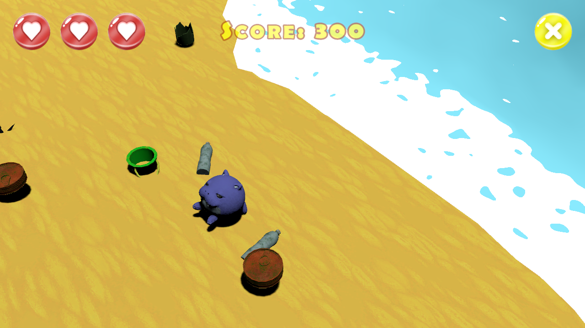

# Star Journey of a Little Fur Seal

A small 3D arcade game about a fur seal harvesting a beach between the waves, made in three days for the
[Ludum Dare 52](https://ldjam.com/events/ludum-dare/52/star-journey-of-a-little-fur-seal) game jam. The seal turns on
the spot all the time; click to hop the way it faces, collect what the sea washes up and keep away from the sharp
things. After seven waves the sea turns to blood.

The Windows build is on [itch.io](https://the-cyberdog-we-deserve.itch.io/star-journey-of-a-little-fur-seal).



## How to play

| Action | Input |
| --- | --- |
| Hop the way the seal faces | Left mouse button |

- Every wave washes ten things onto the beach. Bottles, buckets, cans and slippers give 100 points each; broken
  bottles and sea urchins hurt. Three hits and the seal is done.
- After the seventh wave the sea turns to blood for three more waves: crabs and sea stars still give points, and the
  beach fills with mines. Survive them to see your score.

## Getting started

1. Install **Unity 6000.3.2f1** (Unity 6.3 LTS) through Unity Hub.
2. Add this folder as a project in Unity Hub and open it.
3. Open `Assets/_Project/Scenes/MainMenu.unity` and press Play.

To build the game, use **File → Build Profiles → Windows → Build**. Both scenes are already in the build list.

## Project layout

```
Assets/_Project/
  Audio/Music/  menu, beach and sea-of-blood loops
  Audio/Sfx/    hop, pickup, hit, wave and ending sounds
  Fonts/        the UI font and its TextMesh Pro atlas
  Materials/    water, blood water, sand and splash materials
  Models/       the seal and the props, each with its textures and materials
  Prefabs/      Seal, plus Pickups/, Hazards/ and Effects/
  Scenes/       MainMenu, Game
  Scripts/      the StarJourney assembly: Gameplay/ and UI/
  Shaders/      the stylized water (Shader Graph)
  Sprites/      HUD, menu, end screens and splash sprites
  Terrain/      the beach
  Textures/     sand textures
```

`Assets/TextMesh Pro/` holds the TextMesh Pro essentials. TextMesh Pro loads its settings from the `Resources` folder
inside it, so that is the one `Resources` folder in the project.

## How the code fits together

- `FurSeal` turns every frame, hops on a click and handles what it touches: a `Pickup` adds points, a `Hazard` is a
  hit. It raises `ScoreChanged`, `HitsChanged` and `Died`.
- Two `Tide`s move the clear sea and the sea of blood in waves and raise `Crested` and `Completed`.
- `TideSpawner` washes a batch of props onto the beach at every crest, reusing them through one `ObjectPool` per
  prefab.
- `GameFlow` starts the sea of blood, ends the game and stops time, and raises `BloodPhaseStarted`, `GameFinished`
  and `SealDied`.
- `Hud` and `EndScreens` listen to those events; `MenuButtons` and `SceneLoader` switch scenes.

## Credits

Made for Ludum Dare 52 by:

- Nazar Markov: design
- Anna Markova: 3D
- Nikita Terlyukevich: code
- Alexey Panasyuk: music
